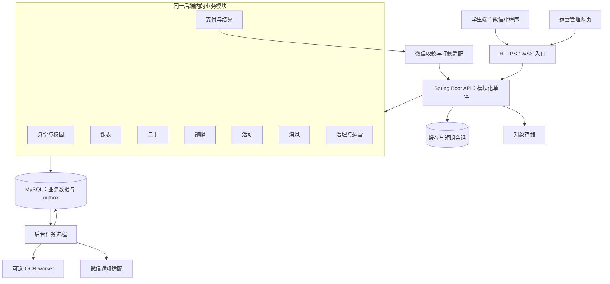

# 校园助手技术架构 v1.1

日期：2026-09-17。性质：进入开发前的架构基线，尚未创建生产系统或完成开源底座编译验证。

本版新增十二个大模块的 76 项子模块设计与独立验收，入口见[详细模块总览](详细模块架构/README-模块总览.md)。本文件保留总体架构；具体子模块接口、共享写入边界和细化锁序以 v1.1 详细设计为准，实施时一并冻结为契约。

## 1. 决策与产品边界

采用 **微信小程序优先、配套网页管理端、模块化单体后端**。一个产品服务多所学校，学校和校区通过数据与配置隔离，不为每所学校复制一套代码。

学生端保留四个业务：课表、二手、跑腿、活动。导航沿用已确认方案：底部“校园／课表／消息／我”，校园页切换“二手／跑腿／活动”。界面采用白色与浅灰背景、克制的绿色强调、适中字体和简单列表。

本架构将基础设施尽量交给成熟项目，把开发投入放在同校身份、交易履约、课表语义和学校运营上。先做可验证的完整闭环，再按实际负载拆服务。

### 首次试点的具体范围

| 领域 | 首次试点交付 | 后续扩展 |
|---|---|---|
| 课表 | 手动录入、表格导入、截图识别草稿、周视图、调课、导入纠错 | 按校授权接入教务、更多模板、提醒增强 |
| 二手 | 出售／求购、搜索、私聊、预约、自提确认、举报 | 在完成独立方案后加入线上支付、毕业打包服务 |
| 跑腿 | 认证跑腿员、下单、接单、履约、取消、争议、收款与结算 | 配送调度、商家订单、更多任务类型 |
| 活动 | 免费活动发布、审核、报名、候补、取消、签到 | 付费活动及退款、商家活动 |
| 运营 | 学校配置、认证审核、内容处理、纠纷工单、推广归因、基础统计 | 学校合作账号、商家经营台、收入分析增强 |

跑腿模块从第一版开始开发；真实付费试点以收款、退款、跑腿员收款路径全部可用为条件。开发测试不依赖商户审批，使用明确标识的模拟网关；生产环境不允许加载模拟网关。二手首次采用线下自提付款，因此不得把“预约成功”统计为已支付交易。

## 2. 技术栈与复用策略

| 层次 | 选择 | 我们负责的部分 |
|---|---|---|
| 学生端 | uni-app Vue3 + TypeScript；unibest 模板；Wot UI | 业务页面、课表网格、校园主题、状态展示与跨端验证 |
| 管理端 | 与芋道后端配套的 yudao-ui-admin-vue3 | 校园运营页面、学校范围选择、字段脱敏 |
| 后端 | ruoyi-vue-pro 的 master-jdk17 分支；Java 17 / Spring Boot 3 系列 | 业务模块、学校权限、幂等、状态机和跨模块协调 |
| 数据库 | MySQL 8.4 / InnoDB；沿用 MyBatis-Plus | 业务表、约束、迁移、查询与事务 |
| 缓存 | Redis 协议客户端沿用上游；Valkey 为首选待验证服务端 | 键命名、过期、缓存失效与故障降级 |
| 文件 | 复用上游存储适配层，生产接 COS 或 OSS，开发用本地存储 | 私有附件授权、上传绑定、清理与审核 |
| 异步任务 | 数据库 outbox + 上游定时任务能力 | 租约、重试、去重、任务看板与补偿 |
| 实时消息 | Spring WebSocket + 原生 WSS | 持久化会话、消息游标、离线补拉、业务卡片 |
| 支付 | 芋道 pay 模块 + 现有 WxJava 适配；按需补充官方 SDK | 支付与业务关联、结算、对账、争议、收款权限判断 |
| 课表解析 | Apache POI；可选 PaddleOCR 独立 worker | 统一课表模型、周次解析、置信提示、确认与撤销 |

来源、许可证及候选项目取舍见同目录《开源复用选型清单》。以上是选型结论，不是“所有版本组合已经运行通过”的声明。P0 阶段固定源码提交和依赖锁文件，跑通兼容基线后才进入业务开发。

### 后端保留范围

保留框架与启动模块、system、infra；按需启用 member、pay。新增校园模块。ERP、CRM、商城、工作流、全套 AI 等无关模块不加入首期运行依赖。这里的“裁剪”优先指不启用模块、移除演示菜单和无关依赖，不是大范围修改上游框架。

尽量在自有模块扩展；必须改上游时保持小补丁并记录原因、涉及版本与回归用例。不要把上游所有类重命名一遍，也不要将其完整商城订单改造成跑腿订单。

## 3. 总体结构



API 和 worker 复用同一后端代码与模块。初期可在一台服务器运行两个进程；需要降低部署复杂度时也可由一个进程同时承担两类角色。任务的抢占、幂等和租约必须从第一天实现，避免扩容后重复执行。OCR 使用独立进程，设置 CPU、内存、超时和并发限制，不能让一张异常图片拖垮交易接口。

不在第一版引入微服务网关、服务注册中心、分布式事务框架、Kubernetes 或大型搜索集群。模块划分先提供代码边界，并不等于每个模块各买一台服务器。

## 4. 代码组织与边界

建议单仓库管理应用与契约；后端目录保持上游结构，便于对照更新。

```text
campus-assistant/
  apps/
    student/                    # uni-app；基于 unibest
    admin/                      # 配套芋道管理端
  backend/
    yudao-framework/             # 尽量少改
    yudao-module-system/
    yudao-module-infra/
    yudao-module-member/
    yudao-module-pay/
    yudao-server/
    campus-module-identity/
    campus-module-media/
    campus-module-timetable/
    campus-module-market/
    campus-module-errand/
    campus-module-activity/
    campus-module-message/
    campus-module-finance/
    campus-module-operation/
  workers/ocr/
  contracts/openapi/             # 学生端、管理端、外部回调契约
  database/migrations/           # 有顺序、可审计的增量 SQL
  deploy/                       # 开发、预发、生产配置模板
  tests/fixtures/                # 脱敏课表、回调与并发场景数据
  docs/adr/                     # 决策和替代方案
  THIRD_PARTY_NOTICES.md
```

每个校园后端模块采用 `api / application / domain / infrastructure / controller` 五类职责。简单模块可采用包级隔离，无需机械拆成五个 Maven 子工程。

- `api` 暴露可调用接口、DTO 和事件类型；不暴露数据库实体。
- `application` 负责用例、权限与事务编排。
- `domain` 定义业务状态、规则和校验。
- `infrastructure` 实现持久化与第三方适配。
- `controller` 处理 HTTP、参数与响应，不承载订单规则。

**表只能由所属模块写入。** 例如跑腿模块通过 Finance API 申请支付，不直接改 pay 表；治理模块通过业务命令下架商品，不直接执行商品 SQL。一般读取通过模块接口；跨域统计允许专门只读查询，但仍执行学校数据权限。

依赖保持单向：基础身份与媒体在下层；四个业务域调用它们；业务域调用 finance 接口，finance 不反向依赖业务实现；消息、搜索和统计消费业务事件。接收支付结果时，由业务模块的事件处理器推进本域状态。

## 5. 模块职责总览

| 编号 | 模块 | 主要职责 | 关键交付 |
|---|---|---|---|
| M00 | 工程底座 | 上游裁剪、构建、配置、数据库迁移、契约、CI | 可重复构建的开发环境 |
| M01 | 身份与校园 | 登录、学校／校区、成员认证、跑腿资格、学校运营权限 | 可复用的用户身份和数据范围 |
| M02 | 媒体与内容基础 | 上传、私有附件、发布审核接入、文件生命周期 | 安全可用的图片和文件服务 |
| M03 | 课表 | 学期、课程、周次、调课、导入草稿与确认 | 导入后可核对的私人课表 |
| M04 | 二手 | 出售／求购、搜索、预约、自提确认 | 从发布到确认成交的流程 |
| M05 | 跑腿 | 任务、接单、履约、取消、争议协调 | 从下单到完成与结算申请 |
| M06 | 活动 | 发布、报名、名额、候补、签到、取消 | 不超卖的免费活动闭环 |
| M07 | 消息 | 私聊、业务通知、已读游标、订阅提醒 | 前后台切换后不丢消息 |
| M08 | 支付与结算 | 收款、退款、台账、打款、对账 | 可追溯的资金状态 |
| M09 | 治理与运营 | 认证队列、举报、争议工单、推广、配置与统计 | 可按学校运营的平台 |
| M10 | 学生端产品壳 | 四标签导航、主题、会话、分包、业务页面集成 | 简洁一致的小程序 |
| M11 | 管理端与发布运维 | 运营界面、观测、发布、备份和恢复 | 可维护且可回退的试点环境 |

详细输入、输出、接口、表归属、依赖和验收见《模块任务与验收清单》。模块编号代表交付责任，不代表必须安排十二个人。

## 6. 身份、多学校与权限

### 6.1 学校不等于租户

第一阶段是一个平台运营主体，服务多个学校。上游 `tenant_id` 固定为服务端配置的平台租户，客户端不能通过请求头自行选择。学校使用独立的 `school_id`，校区使用 `campus_id`。

未来出现独立学校采购、独立经营主体或独立数据库需求时，再设计真正的 SaaS 租户。不能直接把学校塞入上游租户表，就宣称学校权限已经完成。

核心关系：`member_user → school_membership → school → campus`。用户是全局身份；认证、跑腿资格和运营授权有学校范围与有效期。切换浏览校区只改变内容上下文，不增加身份权限。

### 6.2 授权方式

| 行为 | 所需授权 |
|---|---|
| 看公开商品与活动 | 按平台配置允许浏览的学校，始终排除联系方式、证件等私有字段 |
| 发布商品、报名活动 | 有效账号，符合该学校配置的认证要求 |
| 接跑腿任务 | 同范围有效跑腿资格，未停用，满足同时履约数量限制 |
| 查看私人课表 | 仅所有者；分享功能另做明确授权 |
| 查看聊天 | 会话成员；治理查阅需具体案件、专门权限、理由和审计 |
| 校园运营 | 后台身份 + 指定学校／校区 + 指定操作权限 |
| 财务处理 | 独立财务角色，按金额与操作类型实施复核；不得直接修改账表 |

每个资源接口都检查“当前用户是否能操作这个资源”，而非只验证已登录。`school_id`、`owner_id`、收款人和金额不能由前端任意指定。后台菜单隐藏不是权限控制。

学校权限同时覆盖列表 SQL、按 ID 详情、批量导出、对象存储签名、WebSocket 订阅和后台任务。自定义 SQL、异步线程以及跨表连接必须纳入越权测试。学校合作账号默认获得必要的运营能力，不自动获得全校聊天、课表或个人收入明细。

### 6.3 微信身份与认证

客户端将临时登录 code 交给服务端，由服务端换取微信身份。按 `(appid, openid)` 绑定内部 member_id；UnionID 只有在实际返回且规则允许时用于关联。管理账号和学生账号使用各自鉴权入口。

手机号码、学校认证和微信登录分别建模。学校认证采用可配置渠道：可验证的校园邮箱、人工审核材料或已获授权的校方接口。系统记录审核来源与有效期，不把用户填的学校名称当作已认证。材料置于私有存储，保留期限独立配置。

## 7. 数据模型与公共约定

### 7.1 公共规范

- 数据库主键可采用上游 ID 策略；JSON 一律以字符串传递 ID，避免 JavaScript 大整数精度问题。
- 金额使用整数分和币种；费率计算采用明确的舍入规则，订单保存当时价格、费率与取消规则版本。
- 技术时间统一存 UTC；课表保留学校时区、当地日期及学期周次。默认时区 Asia/Shanghai 不等于把所有日期硬编码为服务器时间。
- 核心表带创建／更新时间、状态、必要的 `version` 和学校范围字段；状态日志追加写入。
- 关键唯一性必须有数据库约束；资金、名额和接单竞争不依赖缓存锁作为最终保证。
- 数据库变更使用版本化迁移。生产禁用自动建表；新增字段先兼容旧应用，再切换读写，最后清理旧字段。

### 7.2 自有核心表

下表是逻辑模型，实施时复用已有合适的用户／支付主表，不重复创建同义表；具体物理映射在 M00、M01、M08 冻结。

| 归属 | 表组 | 关键字段或约束 |
|---|---|---|
| 身份 | `campus_school`, `campus_campus` | 学校、校区、时区、启用状态；校区归属校必须一致 |
| 身份 | `campus_membership`, `campus_verification` | user、school、campus、认证状态／期限；同一成员关系唯一 |
| 身份 | `campus_runner_qualification`, `campus_operator_grant` | 学校范围、角色、有效期；资格与账号状态分别校验 |
| 媒体 | `campus_media_asset` | owner、用途、对象 key、审核状态、可见性、到期时间 |
| 课表 | `tt_term`, `tt_period_scheme`, `tt_course`, `tt_meeting`, `tt_override`, `tt_import_job` | owner、学期周一锚点、节次时间、有效周集合、日期覆盖、草稿版本 |
| 二手 | `market_listing`, `market_reservation`, `market_confirmation` | seller、school/campus、价格、当前预约、版本、双方确认及成交来源 |
| 跑腿 | `errand_order`, `errand_runner_load`, `errand_status_log`, `errand_evidence` | requester、runner、价格快照、履约状态、并发额度、状态历史 |
| 活动 | `activity_event`, `activity_registration`, `activity_checkin` | capacity、occupied、候补序号；event/user 唯一，签到唯一 |
| 消息 | `msg_conversation`, `msg_member`, `msg_message`, `msg_notice` | 成员权限、会话内 seq、已读 seq、client_message_id 去重 |
| 财务 | 上游支付／退款表 + `fin_business_payment`, `fin_business_fund_guard`, `fin_settlement`, `fin_payout`, `fin_ledger_txn`, `fin_ledger_entry`, `fin_reconcile_case` | 商户单号唯一、业务关联、权威冻结记录、分配版本、借贷平衡、差异处理状态 |
| 运营 | `ops_case`, `ops_action_log`, `ops_channel`, `ops_attribution`, `ops_feature_config` | 处理理由、对象快照、推广渠道、配置版本及生效范围 |
| 底座 | `campus_outbox`, `campus_event_consumption`, `campus_idempotency` | event_id、consumer 去重，租约、重试；用户＋操作＋幂等键唯一 |

数据库性能索引从真实入口设计：例如商品列表 `(school_id, campus_id, status, created_at, id)`；待接单列表按校区、状态、截止时间；个人订单按 requester/runner 和创建时间；消息唯一 `(conversation_id, seq)`；outbox 按状态、下次执行时间、租约过期时间。上线前通过执行计划和测试数据验证，不能假设一个大联合索引覆盖所有筛选。

## 8. 业务流程与一致性

### 8.1 课表：先产出草稿，再写正式数据

统一模型：`学期 → 课程 → 上课安排 → 日期例外`。一门课可以有多条安排，不同周、星期、教室分别记录。单双周和非连续周在解析后统一成有效周集合；学期第 1 周的周一日期由用户核对。调课用明确日期覆盖，不破坏原周期规则。

导入链路：上传授权 → 文件检查 → 异步解析 → 规范化草稿 → 标出低置信字段和冲突 → 用户修改／确认 → 事务写入正式课表。重复确认同一草稿只能生成一次；导入失败不清空原课表。覆盖导入前提供差异预览，并保留可撤销版本。

CSV/XLSX 优先做确定性解析。截图 OCR 只提供识别文本、位置与结构候选，课程名称、周次、节次和教室仍需业务规则验证。学校模板适配器是插件式代码，不是一套学校对应一份系统。第一版不承诺全国教务系统一键登录；不收集学生教务密码到本系统。

### 8.2 二手：交易状态与真实性分开

出售帖生命周期：`DRAFT → PENDING_REVIEW → AVAILABLE → RESERVED → SOLD`，另有拒绝、下架、过期分支。求购帖独立记录需求与关闭结果，不强行套用出售付款流程。

预约时在同一事务检查商品版本、状态、买卖双方和学校范围，原子写入当前有效预约。取消或到期释放预约；晚到的确认不得把已关闭预约恢复。双方可确认自提完成；卖家也可标记“其他渠道售出”，两者使用不同成交来源。

平台内预约数、双方确认成交数和卖家自行标售数分别统计。线下成交金额只能是用户申报值，不能等同经支付渠道验证的 GMV。

### 8.3 跑腿：接单、履约与资金分别建模

履约状态建议：`DRAFT → WAITING_PAYMENT → OPEN → ACCEPTED → IN_PROGRESS → DELIVERED → COMPLETED`。取消是独立合法转移，争议通过关联案件与冻结标记表示，不能覆盖支付历史。

1. 服务端计算费用、记录规则版本并创建订单，申请关联支付单。
2. 可信支付结果到达后开放接单；用户端“支付成功”只触发查询。
3. 接单事务依次锁定资格行、任务行、跑腿员负载行，检查订单仍 OPEN、接单人不是下单人、资格有效且不超限，然后更新 runner 和状态。资格停用共用资格锁且不反向锁订单；完成／取消按订单→负载锁序释放额度，不反向锁资格。死锁做有界重试。
4. 取件码、精确联系方式等私有字段，仅在有效接单关系成立后按用途返回；公开列表只显示粗粒度取送区域。
5. 跑腿员提交送达证据；用户确认后完成。若配置自动确认，必须已有提醒、等待期限且无未解决争议，所有期限在下单时展示。
6. 完成后创建结算分配，经过适用的争议等待／审核后申请打款；界面区分“订单完成”“待结算”“转账处理中”“已到账”。

两个跑腿员同时接单只允许一个成功；同一个跑腿员同时接不同订单也不得越过并发额度。取消、送达、确认和客服处理使用状态前置条件与版本，失败返回当前真实状态。

争议受理不能只写一条异步“冻结资金”事件。案件受理和 `FinanceApi.freezeSettlement` 必须在同一数据库事务提交，财务 API 加入调用方事务，事件仅用于后续通知。以业务类型＋业务 ID 唯一的 `fin_business_fund_guard` 保存权威冻结状态，即使结算尚未创建也要能冻结；之后创建结算必须继承该状态。冻结原因按 reasonType＋reasonId 独立保存，关闭一个案件仅解除该原因，不清空其他争议、退款或对账冻结。

结算生成、退款预占和打款转入执行中，都先锁定同一业务资金控制记录，再按固定顺序操作结算和具体资金单。与争议竞争时，若冻结先提交则禁止新增打款；若打款已进入执行阶段，案件显示“转账处理中／已执行，撤回结果待确认”，不能承诺资金已完全冻结。

### 8.4 收款、退款、结算、打款是不同对象

`PaymentGateway` 负责预支付、查单、关单、退款、退款查询、账单与回调解析。`PayoutGateway` 负责发起／查询／必要时撤销转账和处理收款人确认。`SettlementService` 负责平台与跑腿员的应收应付分配。业务层只调用这些接口，不持有微信密钥。

支付单：待支付／成功／关闭；退款单：申请／处理中／成功／失败；结算：冻结／可结算／执行中／完成／异常；打款单需映射渠道的处理中、待收款人确认、成功、失败等状态，并保留渠道原状态。未知状态进入待核对，不推断成功。

核心不变量：

- 同一商户单号、回调事件或渠道成功流水只能产生一次有效业务结果和一次账务影响。
- 支付回调校验签名、原始报文、商户与应用归属、币种、金额及订单关联；金额不一致转异常，不能自动修正业务金额。
- 退款申请先预占可退金额，累计成功退款与在途退款不得超过实付金额。
- 退款与打款申请在同一结算分配行上串行协调；有争议时冻结未执行的打款。
- 打款已被渠道受理后，不能假设本地取消即可撤回。查询到明确终态后才能释放资金预占。
- 已打款后发生退款，需要显式记入平台垫付／追偿异常流程，不能伪造“跑腿员款项已收回”。

支付超时、用户重复点击、回调重放或渠道查询结果晚到时，都复用原商户单号查询。请求超时表示结果未知，不表示失败。支付成功时业务订单若已关闭，应进入补偿退款流程，而不是重新开放接单。

内部采用追加式业务资金台账，记录每一笔收款、退款、费用、应付和打款及来源；冲正新增记录，不修改历史金额。台账不是给学生开设可充值提现的钱包，也不替代公司正式会计账。财务展示必须区分交易总额、平台服务费、支付成本、补贴、退款与最终收益。

收款与打款权限分开配置；商户主体、产品开通、appid 绑定与收款人确认流程属于真实上线依赖。微信相关能力以接入时官方规则和实际获批权限为准。[小程序支付文档](https://pay.wechatpay.cn/doc/v3/merchant/4012791911)、[商家转账文档](https://pay.wechatpay.cn/doc/v3/merchant/4012715211)。

### 8.5 活动：不超额、不重复、不丢候补

活动发布状态与报名状态分开。报名事务锁定活动容量记录，检查活动有效且未截止，然后插入或更新该用户唯一报名记录。占用名额只能原子增加；额满进入候补，候补排序使用服务端序号。

取消报名原子释放名额并写出候补提升事件；处理器仍需再次锁容量记录检查资格，不能仅靠消息推送“你已转正”。签到由报名人与活动关系授权，单次凭证过期、重复扫码幂等。

首次免费活动无需接入支付。未来付费活动增加短期名额预占；支付成功确认报名，超时释放，释放后晚到的支付进行退款补偿。取消整场活动进入后台批处理，每条报名有可追踪结果，不用一个长事务操作全场。

### 8.6 消息：数据库持久化，WSS 提升及时性

发送消息先检查会话成员和业务上下文，再写消息与 outbox，成功响应携带服务器 seq。客户端生成 `client_message_id`，重复发送返回原结果。会话内 seq 在事务中分配；已读游标只能向前移动。

WSS 推送可能重放或丢失，因此前端按 seq 去重，并在重连、回到前台时通过 HTTP 补拉。撤回或审核删除保留占位和序号；未读数由持久化游标计算。订单通知保存事件快照，但实际可操作状态从业务接口重新读取。

客户端使用短期、单次用途的连接票据，避免将长期访问令牌放入可记录的连接 URL。服务端按用户绑定连接，订阅会话重新检查成员权限。微信订阅消息是额外提醒能力，用户授权或投递失败都不能影响订单状态。

本方案选标准 WebSocket。原生 WebSocket 客户端不能直接当作 Socket.IO 客户端；不要混用协议。[Socket.IO 官方说明](https://socket.io/docs/v4/)、[uni-app WebSocket 接口](https://en.uniapp.dcloud.io/api/request/websocket.html)。

## 9. API 与事件契约

沿用上游学生端 `/app-api/`、管理端 `/admin-api/` 的入口划分，自有接口统一放在 `campus/v1` 命名空间。支付渠道回调使用独立路径，并由渠道签名机制验证，不能套学生登录校验。

| 示例接口 | 用途 | 关键约束 |
|---|---|---|
| `GET /app-api/campus/v1/context` | 用户、学校、资格与模块可用性 | 返回服务端可授权范围 |
| `POST /app-api/campus/v1/media/upload-tickets` | 申请上传 | 绑定 owner、用途、体积与文件类型 |
| `POST /app-api/campus/v1/timetable/imports` | 创建导入任务 | 仅可使用自己的有效附件 |
| `POST /app-api/campus/v1/timetable/imports/{id}/confirm` | 确认导入草稿 | 草稿版本、幂等键 |
| `POST /app-api/campus/v1/market/listings/{id}/reservations` | 商品预约 | 商品版本、成员权限、唯一有效预约 |
| `POST /app-api/campus/v1/errands` | 创建任务 | 服务端计价、规则版本、幂等键 |
| `POST /app-api/campus/v1/errands/{id}/accept` | 接单 | 资格、额度、状态竞争 |
| `POST /app-api/campus/v1/errands/{id}/complete` | 确认完成 | requester 身份、当前状态、幂等键 |
| `POST /app-api/campus/v1/activities/{id}/registrations` | 报名／候补 | 唯一报名与容量事务 |
| `GET /app-api/campus/v1/conversations/{id}/messages?afterSeq=...` | 消息补拉 | 会话成员、数量上限 |
| `POST /app-api/campus/v1/payments/{id}/prepay` | 获取支付参数 | 本人、金额快照、有效支付单 |
| `POST /admin-api/campus/v1/cases/{id}/actions` | 客服处理 | 学校范围、操作权限、理由、版本 |

HTTP 响应统一业务 code、message、data、traceId。列表采用游标或明确分页，不返回无上限全集。状态冲突返回可识别错误及当前资源版本，前端刷新后让用户判断，不自动重复金额操作。

对创建订单、预约、报名、确认、退款等写操作支持 `Idempotency-Key`。作用域为用户＋操作类型＋键，并保存请求摘要；同键不同请求体返回冲突，同键同请求返回原结果。业务唯一约束独立存在，不能因为幂等记录过期就允许重复付款。

事件示例：

```json
{
  "eventId": "01J-CAMPUS-EXAMPLE",
  "eventType": "finance.payment_succeeded.v1",
  "aggregateType": "payment",
  "aggregateId": "102400001",
  "aggregateVersion": 2,
  "schoolId": "1001",
  "occurredAt": "2026-09-17T04:00:00Z",
  "traceId": "example-trace",
  "payload": {
    "businessType": "ERRAND",
    "businessId": "102400000",
    "amountFen": 500,
    "currency": "CNY"
  }
}
```

事件不携带证件、取件码或完整手机号。业务修改和 outbox 写入必须在同一数据库事务提交；后台任务在提交后调用外部服务。消费者成功标记与内部状态变更同事务提交；外部调用通过固定渠道单号幂等。处理语义是“至少一次投递＋业务去重”，不承诺网络层恰好一次。要求立即生效的资金冻结必须使用前述同步事务，不以最终一致的事件替代。

租约过期可重新领取，指数退避加抖动，有最大尝试次数和人工重放入口。乱序事件依据状态与 aggregateVersion 处理；消费者不能直接把旧事件状态覆盖到最新订单。Redis 广播仅作唤醒提示，丢失提示后仍由数据库补偿扫描完成。

## 10. 搜索、内容与运营

首次搜索按学校／校区筛选后，使用 MySQL ngram 全文索引处理中文标题和描述；单字、缩写及特殊分类提供受限的精确／前缀查询策略。限制查询长度、分页深度和候选数量，参数化 SQL。索引效果以真实商品语料检验。[MySQL ngram 官方文档](https://dev.mysql.com/doc/refman/8.4/en/fulltext-search-ngram.html)。

公开内容与私有附件分开：商品图可进入公开审核流程；证件、取件码截图、聊天图和课表图默认私有。上传先申请授权，完成后验证对象实际大小、类型与归属，绑定业务对象后才可展示。业务数据不要存不可撤销的永久公网敏感 URL。

内容状态包括待检查、通过、拒绝、人工复核；审核服务异常时高风险发布保留在待审核队列。私有课表处理不自动发布为公共内容。举报生成统一案件，但最终状态变更调用对应业务模块，保存处理理由与操作者。

运营后台支持渠道二维码或邀请码归因，记录首触达与注册来源。校园推广者只能查看自身授权的汇总数据；用户隐私不因渠道合作而共享。收入看板来源于支付和台账，成交看板来源于业务事件，两者分开。

## 11. 前端架构与视觉约束

主包承载登录、校园选择、四标签入口与共享组件；详情、发布、导入和订单等页面按二手／跑腿／活动／课表分包。Tab 页面保留轻量入口，业务分包不能通过共享大依赖把全部页面重新拖入主包。具体包大小通过微信开发工具实际构建验收。

统一请求客户端、错误处理、令牌更新、金额格式、上传和埋点。业务 store 只由所属模块操作；跨模块通过 API 或共享只读上下文通信。消息卡片里的订单状态变化后重新拉取服务端数据，不修改其他模块 store 内部字段。

样式基线：正文 16px 左右、辅助文字 13–14px、标题 18–20px；触控区域原则上不小于 44px；容器间距以 8px 递增；重要按钮位置固定且文字明确。采用系统字体，弱化阴影，避免密集色块、过大的卡片圆角和每页多个悬浮按钮。金额、地点、时间优先清晰展示。

发布表单按必要字段逐步展开；草稿自动保存；空列表提供明确下一步；网络差时保留已填数据。重要提交按钮展示处理中状态，但真实去重仍由后端保证。表单错误紧贴字段展示，退款、候补、审核等状态使用可理解的文字。

网页预览可以帮助沟通，但微信登录、上传、支付、软键盘、安全区、前后台切换和订阅消息必须在真机验证。H5 支付路径若未单独实现，隐藏对应入口，不将小程序支付参数直接交给网页。

## 12. 部署、观测与恢复

### 12.1 环境

开发：本地数据库、缓存、文件服务、模拟微信网关和任务 worker。预发：独立数据库／存储前缀／密钥，使用测试账号与脱敏数据。生产：固定版本镜像、托管数据库优先、对象存储、HTTPS 入口与监控。

初期采用容器部署 API 和 worker；数据库不和发布过程一起销毁。服务环境变量或密钥系统注入凭据，不提交私钥到仓库。回调入口与学生 API 共享监控但有各自限流策略；真实支付回调不能被普通登录限流误拦截。

### 12.2 验证目标，非已测性能

先以 1–3 所试点学校、累计 2 万注册用户作为容量建模假设；它不是获客预测。首轮压测目标：普通读接口 100 req/s、500 个在线 WSS 连接、普通读请求 p95 ≤ 500ms（不含第三方接口），并发接单和报名保持零重复分配。用接近真实的数据分布压测，记录服务器规格、数据规模、持续时间与错误率；未达到就优化或调整目标。

观测包括：请求 traceId、接口错误与延迟、数据库慢查询、outbox 堆积年龄、OCR 等待时间、支付未知态、退款与打款在途时长、账单差异、WebSocket 重连。日志不得包含访问令牌、微信密钥、完整证件和取件码。管理员敏感操作另有审计日志。

### 12.3 降级

| 故障 | 行为 |
|---|---|
| OCR 不可用 | 导入任务提示延后，允许手动／文件导入，交易不受影响 |
| WSS 断开 | 前端 HTTP 补拉，关键通知保留在消息中心 |
| 缓存不可用 | 会话相关能力按实际依赖受控失败；关键交易仍由数据库约束，不绕过认证；可缓存的公开读限流降级 |
| 支付渠道异常 | 保留待确认状态并查原单，暂停新增付费订单；不直接显示失败并重新扣款 |
| 对象存储异常 | 保存文本草稿，重试上传；缺少必要证据时不假装提交成功 |
| 后台任务暂停 | 任务持久保存，恢复后按幂等和租约补处理 |

### 12.4 备份与发布

数据库采用全量备份和增量日志，生产前演练恢复；初始目标 RPO ≤ 15 分钟、RTO ≤ 4 小时，是否达标必须用实际方案验证。支付后不能只凭数据库旧备份恢复营业，还需按渠道流水补齐丢失时间窗并对账。

发布先预发检查，再按学校开关灰度。数据库迁移采用向前兼容；应用回退不自动回滚已发生的交易或删除新数据。功能开关可按学校控制新发布、跑腿接单、截图导入和付费功能；关闭新增业务不阻止已存在订单完成、退款和对账。

## 13. 分期与变更边界

顺序为：P0 开源底座兼容验证 → P1 公共身份／媒体／消息与产品壳 → P2 四业务闭环 → P3 真实资金联调及异常处理 → P4 单校试点和运营验证。P 编号表示阶段，M00–M11 表示模块责任。

课表、二手、免费活动可以先试用；跑腿可先在模拟环境完成全链路，然后在真实收款与打款条件满足时按学校开启。不能为了同步发布四个菜单而让资金状态只做展示。

只有以下证据成立才增加基础设施：持久化任务吞吐成为瓶颈时引入消息队列；搜索相关性或索引规模超出数据库方案时引入专门搜索；某模块需要独立发布或明显独立扩容时拆服务。多学校上线首先是配置和运营问题，不是微服务数量问题。

## 14. 开发前必须落定的事项

这些是实施检查点，不要求现在暂停架构讨论：

1. 固定前后端提交和依赖版本，完成构建、许可清单与已知漏洞检查。
2. 确认首个试点学校／校区与真实脱敏课表样例，冻结首批导入模板。
3. 明确学校认证依据和跑腿员审核责任人，给后台配置最小权限。
4. 确定经营主体、微信小程序、商户号以及实际可用的跑腿员收款方式，完成小额实测。
5. 冻结取消、争议、自动确认和收费规则；规则变更保留版本，不追溯修改历史订单。
6. 选择云服务并完成备份恢复、真机测试和异常流程演练，再开放真实付费功能。

完整产品功能与视觉要求继续以同目录《校园助手产品与视觉方案》为产品基线；本文件负责工程实现边界。
