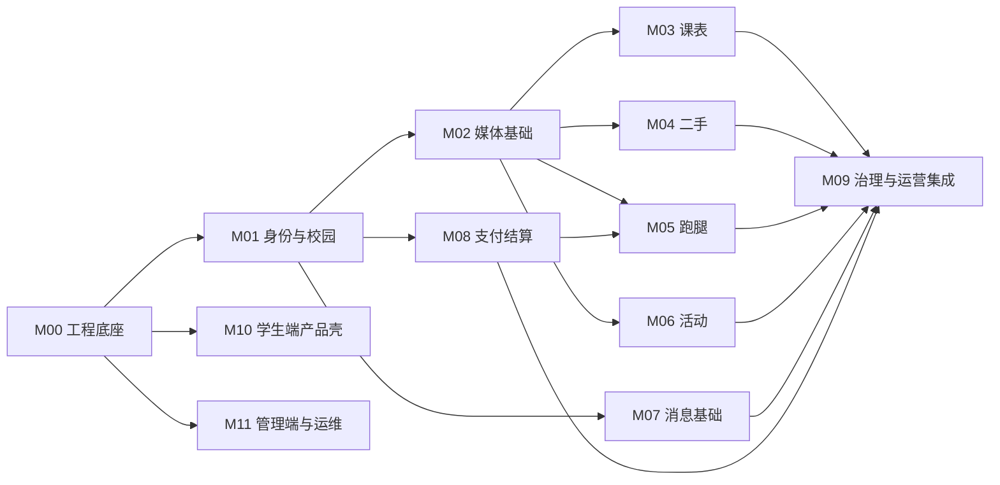

# 校园助手：模块任务与验收清单

日期：2026-09-17。用途：把架构转为可分工、可测试、可集成的开发任务。本文描述待实施工作，不表示任务已经完成。

十二个大模块现已进一步拆成 76 个小模块，见[子模块总览与开发顺序](详细模块架构/README-模块总览.md)。本文件保留大模块验收；具体分派应使用 Mxx.yy 子模块设计及公共 A／B／C 验收规范。

## 1. 协作约定

每个模块设一个责任人，负责所辖后端、数据库迁移、契约与业务测试；学生端和管理端责任人负责 UI 一致性与集成。同一人可以承担多个模块。

所有任务均需说明：输入、输出、公开接口、数据归属、依赖、验收证据。后续由 AI 或多人执行时，必须告知执行者共享代码库中还有其他修改，不得回退他人的改动。跨模块变更先调整契约，再协调实现，不绕过边界直接改别人的表。

实现开始前由 M00 固定错误码、ID／金额类型、OpenAPI 生成方式、迁移命名、幂等规则与事件信封。业务模型发生变化时同步更新契约和数据迁移，不能只改前端字段。

## 2. 模块依赖



这是交付依赖图。消息基础可先建；具体订单卡片、举报处理及统计在各业务契约完成后接入。M10、M11 从基础阶段开始，持续集成所有业务模块。免费活动不依赖支付模块；将来付费活动再接入 M08。

内容审核服务通过底座端口调用，治理后台消费待审核事件并调用各业务的审核命令。业务域不反向依赖治理模块实现，避免循环依赖。

## 3. M00 工程底座

**目标：** 让选择的开源组件能重复构建和部署，为所有模块提供统一运行规范。

**负责范围：** 后端上游裁剪、启动模块、公共配置、`contracts/`、`database/migrations/`、CI、outbox 与幂等基础；前后端初始模板由 M10／M11 在约定下接入。仅此模块修改框架级公共行为。

**输入：** 开源复用清单、架构文档、固定源码和依赖。

**输出／接口：** 公共错误、traceId、事务／幂等工具、事件发布接口、定时任务领取器、配置与特性开关接口；OpenAPI 基线和可启动开发环境。

**数据：** `campus_outbox`、`campus_event_consumption`、`campus_idempotency`；数据库迁移版本记录。

**复用：** 上游工程、配置、鉴权基础、任务调度、数据访问和测试结构。新增 outbox 可靠性、校园公共约定和适配验证，不新建完整通用框架。

**验收：**

- 干净环境根据文档可安装依赖、运行迁移、启动后端和两端前端；交付源码 SHA、锁文件与构建记录。
- Java／Spring、MySQL、缓存客户端与服务端实际兼容；无关模块未被启动依赖拉入。
- 模拟任务处理进程中途退出，租约过期后可接续；重复投递不重复落业务结果；失败进入可观察的重试／人工处理状态。
- 幂等键同请求返回同结果，不同请求体返回冲突；并发请求也满足约束。
- 构建检查、关键测试、依赖清单与密钥扫描接入 CI。默认账号、演示密钥和公开调试端点完成生产裁剪。

**依赖：** 无。完成此模块的可运行基线后，才能给其他模块估算可靠工期。

## 4. M01 身份与校园

**目标：** 建立学生、学校、校区和运营人员的可信身份与权限范围。

**负责范围：** `campus-module-identity`，已有 member/system 的适配，不另建同义用户体系。

**输入：** 微信登录 code、成员认证材料引用、学校配置、管理员授权。

**输出／接口：** `IdentityApi.currentUser`、`CampusScopeApi.assertAllowed`、`MembershipApi.check`、`RunnerQualificationApi.check`；HTTP 登录、上下文、学校选择、认证提交与审核接口。

**数据：** 学校、校区、成员关系、认证记录、跑腿资格、学校运营授权；微信身份映射优先复用已有合理结构。

**复用：** 上游账号、Token、后台 RBAC、微信身份接入。新增学校范围与资源级授权。

**验收：**

- 同一微信身份重复登录绑定同一用户；过期／无效 code 不创建混乱身份。
- 用户切换 campus_id 或伪造 tenant／school 请求头不能获得认证或操作他校订单权限。
- 校园运营 A 无法通过列表、详情、导出、附件签名或批量接口读取学校 B 的受限数据。
- 认证过期、跑腿资格停用即时影响后续敏感操作；已有未完成订单进入明确处理路径，不直接消失。
- 学生 Token 不能访问后台接口；后台普通运营账号不能执行财务处理。
- 课表私有、聊天成员授权、证件附件授权有可复用的资源权限接口及越权测试。

**依赖：** M00；认证材料上传由 M02 接入，可先以测试附件引用验证契约。

## 5. M02 媒体与内容基础

**目标：** 支持图片和课表文件，并正确隔离公开商品图与私有材料。

**负责范围：** `campus-module-media`，存储与内容检查适配器。人工审核页面归 M09／M11。

**输入：** 文件用途、预期类型／大小、所有者、业务绑定请求。

**输出／接口：** `MediaApi.issueUploadTicket`、`bind`、`authorizeDownload`、`getInspectionStatus`、`expire`；上传完成通知和附件状态事件。

**数据：** 媒体元数据、对象 key、归属、可见性、审核与保留状态。业务表保存 asset_id，不存私有永久 URL。

**复用：** 上游文件服务与云 SDK。新增用途授权、上传确认、私有签名和孤立文件清理。

**验收：**

- 客户端声明类型与实际文件不符时被拒绝；超大文件、异常图片和压缩文件受资源限制。
- 用户不能绑定别人的 asset_id；下载签名必须执行业务资源权限，地址有效期受限。
- 私有课表、证件和跑腿证据不会出现在公开 CDN 地址、搜索索引或普通运营列表中。
- 上传完成但未绑定的文件按配置清理；有纠纷保留标记的证据不被普通过期任务删除。
- 检查服务故障时状态明确，公开发布不直接默认通过。

**依赖：** M00、M01。

## 6. M03 课表

**目标：** 提供可靠的私人周课表和可纠错的导入过程。

**负责范围：** `campus-module-timetable`、`workers/ocr/`、学校解析模板、脱敏课表样本。页面由 M10 集成。

**输入：** 学期周一锚点、节次表、手动课程或本人上传文件／截图。

**输出／接口：** 学期设置、周视图数据、导入任务状态、草稿、差异预览、确认、撤销、日期调课 API；内部 `TimetableParser`／`OCRAdapter`。

**数据：** term、period_scheme、course、meeting、override、import_job 及导入版本。正式课表与未确认草稿分开。

**复用：** POI 文件解码、PaddleOCR 可选识别、已有日期库。自己实现周次／节次语义和确认机制。

**验收：**

- 样本覆盖单双周、非连续周、同课不同教室、跨月周视图、停课与补课；预期周视图与人工标注一致。
- 文件或截图识别结果先显示草稿；低置信／缺失字段要求核对，不能悄悄生成正式课程。
- 重复确认不重复插课；导入失败不覆盖原课表；撤销恢复到明确版本。
- 任务超时、重复回调和 OCR worker 重启能够恢复或进入明确失败状态。
- 文件资源受限，OCR 原始附件与草稿有可配置保留期限；不收集教务密码。
- 精度报告按选定学校的脱敏样本记录字段正确率、整表无需修改比例、失败类型和耗时，不只展示成功截图。

**依赖：** M00、M01、M02。截图导入的效果须有真实样本支持，不能以 mock 数据验收准确率。

## 7. M04 二手

**目标：** 从出售／求购发布到预约、自提确认，获得真实可解释的成交数据。

**负责范围：** `campus-module-market`、领域状态、搜索查询、商品／预约迁移与测试。

**输入：** 图片、描述、成色／瑕疵、价格、校区、预约与确认命令。

**输出／接口：** 发布、检索、详情、预约、取消、确认、关闭／下架；`MarketContextApi` 提供聊天所需最小商品信息；发布与成交事件。

**数据：** listing、reservation、confirmation。当前有效预约由商品行绑定，历史预约保留。

**复用：** CRUD、表单、上传、数据库全文检索、消息基础。自己实现预约竞争、角色与成交语义。

**验收：**

- 同一商品并发预约仅有一条有效预约；重复请求返回原结果。
- 预约过期、取消与卖家确认竞争不会复活已关闭交易；商品下架不删除历史证据。
- 商品所有者不能预约自己；非交易参与者不能确认或读取私有约定信息。
- “双方确认成交”和“卖家标记其他渠道售出”进入不同统计字段；不生成虚假的已支付流水。
- 中文搜索与学校／校区筛选共同生效，删除／下架内容不会从搜索继续泄露。
- 正常路径在手机端完成发布、私聊、预约、取消或确认，没有只有按钮没有后端动作的占位流程。

**依赖：** M00、M01、M02；消息联调依赖 M07。

## 8. M05 跑腿

**目标：** 正确处理任务接单、履约与取消，并向财务模块提交可靠的支付和结算请求。

**负责范围：** `campus-module-errand`、跑腿状态机、任务规则与私有履约信息；资金表由 M08 独占。

**输入：** 任务信息、计价配置、跑腿资格、支付结果、接单／送达／确认／取消命令、客服决定。

**输出／接口：** 创建／接单／开始／送达／完成／取消 API；`ErrandAdminApi.applyResolution`；调用 `FinanceApi.createPayment`、`requestRefund`、`prepareSettlement`，发布履约事件。

**数据：** order、runner_load、status_log、evidence；保存计价与取消规则快照。

**复用：** 账号、认证、存储、支付网关、消息、事务与管理后台。自己实现接单并发、履约规则及与资金的协调。

**验收：**

- 至少 100 个并发接单请求争抢同一订单，仅一个成功；同一跑腿员并发接多单不超过配置额度。
- 接单使用数据库状态前置条件，缓存失效不造成重复接单；死锁重试有界且最终结果可查询。
- 未付款订单不可接；用户端伪造支付成功不能开放任务；取消后晚到的真实付款进入退款补偿。
- 取件码及精确联系方式仅在合法履约关系中可见；换订单 ID 无法读取。
- 送达、确认、取消、争议操作乱序或重放不会越过合法转移；自动确认跳过争议订单。
- “已完成但未到账”清晰可查；结算只创建一次；关闭新增跑腿功能后旧订单仍能完成／退款。
- 模拟全链路与真实小额资金联调分别标记验收，不相互替代。

**依赖：** M00、M01、M02、M08；通知联调依赖 M07；客服界面集成在 M09／M11。

## 9. M06 活动

**目标：** 支持免费校园活动，可靠分配名额、候补与签到。

**负责范围：** `campus-module-activity`，容量与报名事务、活动状态和主持人权限。

**输入：** 活动内容、时间地点、名额、报名限制、报名／退出／签到命令。

**输出／接口：** 活动发布／审核／详情、报名／候补／退出、签到、取消；活动状态和名额变更事件。

**数据：** event、registration、checkin；event/user 唯一报名关系，候补服务端顺序。

**复用：** 内容、上传、表单、消息、数据库锁。自己实现容量、候补和身份规则。

**验收：**

- 10 个名额接受 100 个并发报名时最多 10 个有效占位，其余按配置候补或失败。
- 同一用户重复报名不占多个名额；退出后再次报名有明确规则，不产生隐性重复关系。
- 取消释放名额与候补提升竞争时不超额；处理进程中断后可继续。
- 非主办方无法查看受限报名资料或执行签到；重复签到幂等，过期凭证无效。
- 取消整场活动后报名状态和通知任务可追踪；通知失败不令活动重新开放。
- 首次付费开关关闭；未来接支付时须额外验收名额预占、晚到付款与退款，不因数据库有 price 字段就宣称付费可用。

**依赖：** M00、M01、M02；提醒联调依赖 M07。

## 10. M07 消息

**目标：** 提供简单、可靠的业务私聊与通知中心。

**负责范围：** `campus-module-message`、WSS 连接认证、持久化与补拉、通知渠道适配。

**输入：** 会话成员、获授权的业务上下文、用户消息、业务事件、已读游标。

**输出／接口：** 创建／查询会话、发送消息、游标补拉、标记已读、短期连接票据；`NotificationApi`；WSS 事件协议。

**数据：** conversation、member、message、notice；client_message_id 去重、会话 seq 和已读游标。

**复用：** Spring WebSocket 传输、前端原生连接 API、上游可用的微信通知适配。自己实现会话权限、持久化语义和卡片契约。

**验收：**

- 非会话成员不能访问历史、订阅或发送；封禁与拉黑规则由服务端执行。
- 同一 client_message_id 重试只显示一条消息；断线期间发送的消息可从数据库补齐。
- 多设备已读游标只前进；撤回／审核删除后不破坏 seq 补拉。
- 支付回调或订单事件重放不发出重复业务通知；旧卡片点击后查询当前订单状态。
- 小程序切后台再返回、弱网重连、票据过期和刷新得到正确状态；不能只在网页常驻连接条件下验收。
- 订阅提醒未授权或投递失败时，站内通知仍存在，业务处理不回滚。

**依赖：** M00、M01；图片依赖 M02，业务卡片在各领域契约完成后接入。

## 11. M08 支付与结算

**目标：** 跑腿收款、退款、应付和实际打款各有明确事实，能够日常对账和人工处理异常。

**负责范围：** `campus-module-finance`、上游 pay 适配、支付／退款／打款回调、台账和对账任务。财务相关数据仅由本模块写入。

**输入：** 服务端批准的业务付款请求、金额快照、取消／完成／争议决定、渠道回调及账单。

**输出／接口：** `FinanceApi.createPayment/queryPayment/requestRefund/prepareSettlement/freezeSettlement`；`PaymentGateway`、`PayoutGateway`；可信支付与资金状态事件；后台财务查询与处理命令。

**数据：** 复用上游合理的支付／退款主表；自有 business_payment、business_fund_guard、settlement、payout、ledger_txn、ledger_entry、reconcile_case；冻结上游与自有表映射，避免两个金额真相来源。business_fund_guard 按业务唯一保存权威资金冻结状态，先于结算也可存在。

**复用：** 芋道 pay、WxJava、必要时官方 SDK；签名算法、报文解密和渠道协议交给 SDK。自己实现业务关联、分配、幂等、补偿、台账与对账。

**验收：**

- 校验原始回调签名和金额、币种、appid／mchid、业务关联；不合格回调不推进订单。
- 同一成功回调重放、主动查单与回调竞争，仅产生一次资金影响；原始请求超时后查原商户单号，不创建第二笔扣款。
- 并发退款正确预占可退金额；退款处理中再退款不能超过实际剩余额度。
- 退款与打款竞争、转账待确认、渠道结果未知、争议冻结、已打款后退款均有测试和可查询处理结果。
- 争议受理与持久化资金冻结同事务完成；暂停异步消费者后提交争议，后台仍不得发起新打款。结算尚未创建时的冻结不会丢失；与在途打款竞争时返回可解释的真实结果，不虚称已撤回。
- 台账交易借贷合计平衡，金额与来源可追溯；更正使用冲正，后台不能直接改成功金额。
- 收款、退款、手续费和打款对账分开；差异形成案件并可重跑，不以支付回调齐全代替对账。
- 支付回调接收结果持久化后才响应渠道；后续业务事件失败可重试，不能因为通知发送失败重复记账。
- 模拟网关仅开发／预发显式启用；生产启动拒绝模拟网关配置。
- 获得实际渠道权限后，小额完成支付、退款、跑腿员到账与账单核对；记录渠道流水证据并脱敏。

**依赖：** M00、M01，第三方商户权限；不依赖跑腿模块实现。业务接口通过业务类型、业务 ID 与事件连接，避免循环引用。

## 12. M09 治理与运营

**目标：** 让校内伙伴和平台人员能处理认证、内容、纠纷与推广，且看得懂业务数据。

**负责范围：** `campus-module-operation`、案件工作流、渠道归因、学校开关、汇总读模型；页面由 M11 集成。

**输入：** 用户举报、待审核事件、客服材料、渠道标识、业务与资金事件。

**输出／接口：** 待办队列、案件处理命令、内容审核命令、学校运营配置、渠道与业务统计；调用各模块公开管理 API。

**数据：** case、action_log、channel、attribution、feature_config；统计聚合表可重算，不反向作为资金事实。

**复用：** 上游权限、操作日志、表格、配置与导出基础。自己实现学校案件范围和指标定义。

**验收：**

- 举报、认证、内容处理形成具体案件；权限、理由、时间与前后状态均可追踪。
- 客服退款走 Finance API，商品下架走 Market API；不直接修改其他域表。
- 推广伙伴只能看获授权渠道汇总；渠道归因不授予学生资料或聊天读取权限。
- 注册、认证、发布、预约、确认成交、跑腿支付、履约、平台服务费分别定义，样本订单能从看板追溯到来源。
- 对账差异和资金未知态能进入待办；操作重试不重复退款或重复结算。
- 按学校关闭模块时，只限制新增行为；已有订单后续履约和资金处理仍可完成。

**依赖：** M00、M01 和相关业务公开接口；开发时先做只读队列，逐步接审核、纠纷和统计。

## 13. M10 学生端产品壳与页面集成

**目标：** 四个业务入口在一款手机应用中保持一致、简单、可用。

**负责范围：** `apps/student`、主题、路由、组件、API 客户端与各业务页面；后端状态规则仍由各领域负责。

**输入：** 产品与视觉方案、OpenAPI、错误码、业务状态、模块可用性。

**输出：** 四标签导航、学校切换、登录与认证、二手／跑腿／活动／课表页面、消息中心、个人订单与设置；模拟数据用于开发展示但与真实模式明确区分。

**复用：** unibest、Wot UI、uni-app 能力；按统一 token 定制，避免创建第二套基础控件体系。

**验收：**

- “校园／课表／消息／我”导航稳定；校园的二手／跑腿／活动切换不丢合理的列表状态。
- 正文适中、主次信息清晰，手机安全区与键盘不遮挡关键提交；长校名、长商品名、空列表、加载与失败状态有完整表现。
- 发布流程可以保存草稿；弱网重试不重复创建；服务端冲突能清楚提示并刷新真实状态。
- 微信真机完成登录、上传、导入确认、私聊重连及已开通支付流程；网页演示不能替代真机记录。
- 页面、静态资源和分包大小通过实际构建检查；敏感字段不写入日志或长期本地缓存。
- 未开通付费能力时展示真实可用范围；不能用假支付成功画面冒充真实业务结果。

**依赖：** M00 公共契约；可以用契约 mock 并行做页面，最后必须对真实 API 验收。

## 14. M11 管理端与发布运维

**目标：** 有可操作的后台和能够诊断、恢复的部署环境。

**负责范围：** `apps/admin`、`deploy/`、发布流水线、监控／告警、备份恢复、运维文档。各领域指标与操作规则由对应模块定义。

**输入：** 配套管理端、后台 API、学校角色、配置、环境密钥和部署资源。

**输出：** 学校配置、认证、内容、订单、纠纷、财务与统计页面；预发／生产发布；恢复手册与演练记录。

**复用：** 芋道 Vue3 管理端、现成容器运行和监控工具、云数据库备份能力；不从零写部署平台或报表引擎。

**验收：**

- 无关演示菜单和默认凭据已清理；学校权限在界面与服务端共同验证，导出敏感字段按权限脱敏。
- 财务确认显示真实影响对象、金额、当前状态与处理理由；重复点击结果一致。
- 预发和生产的数据库、对象路径与凭据隔离；生产包可定位到源码与依赖版本。
- 展示请求延迟／错误、任务积压、支付未知态、对账差异与 OCR 失败；告警能定位负责模块。
- 演练数据库恢复，验证备份完整性及目标 RPO／RTO；资金恢复后有渠道补账核对步骤。
- 发布和应用回退经过演练，迁移不删除已有交易；关闭功能后历史订单可继续处理。

**依赖：** M00，随后持续集成 M01–M09。

## 15. 分阶段里程碑

| 阶段 | 交付物 | 通过条件 | 主要涉及模块 |
|---|---|---|---|
| P0 底座验证 | 固定版本源码、最小可运行前后端、许可证／依赖清单、契约基线 | 干净环境构建，微信真机打开，登录／上传／后台权限可用；待验证组件给出明确去留 | M00、M01／M02 最小路径、M10、M11 |
| P1 公共能力 | 学校认证、私有附件、消息中心、产品壳、后台基础 | 跨校越权检查通过，消息重连补齐，上传权限成立 | M01、M02、M07、M10、M11 |
| P2 业务闭环 | 课表、二手、免费活动、模拟资金下的跑腿与后台 | 四个完整流程及并发／乱序测试通过，真实数据样本验证课表 | M03–M06、M08 模拟网关、M09 |
| P3 真实资金 | 收款／退款／打款／对账及异常处理 | 实际权限具备；真实小额闭环、渠道账单核对、争议处理通过 | M05、M08、M09、M11 |
| P4 单校试点 | 真实配置、运营人员、真机报告、恢复演练、指标看板 | 未解决的资金重复、越权、超额分配问题为零；运营知道如何处理失败流程 | 全模块 |

这些阶段是交付顺序，不是日历承诺。P0 完成后，按实际代码适配量、人员投入与外部审批条件估算工期。商业冷启动与校内运营可与工程并行，但用户数和收入不能作为开发已完成的证据。

## 16. 总体验收与工程交接

验收证据包含：版本清单、迁移记录、关键接口契约、运行说明、真机演示记录、异常场景测试、并发测试、资金实测和恢复演练。不能只交一组正常页面截图。

关键交易与权限测试在后端执行；前端只针对真实业务路径和易出问题的交互做必要验证。不要为每个样式、字段赋值或简单可撤销页面改动写镜像式测试。

模块交接模板：

```text
模块编号／负责人：
固定源码与依赖版本：
目标与已完成范围：
公开 API／事件／错误码：
数据库迁移及表归属：
依赖模块与第三方条件：
复用来源、许可、上游补丁：
验收命令／数据／证据：
已知限制与未通过项：
发布开关、监控与恢复办法：
```

架构负责人最终复核权限、资金、事务、模块依赖和发布恢复；模块实现者负责提交可运行证据。普通表单和页面可以独立开发，资金与跨域规则变更必须经过集成复核。
